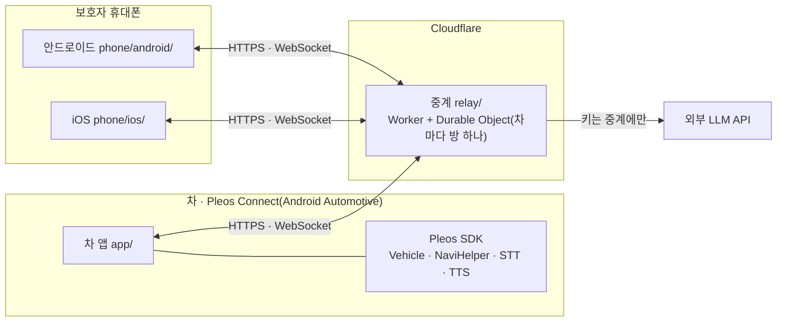
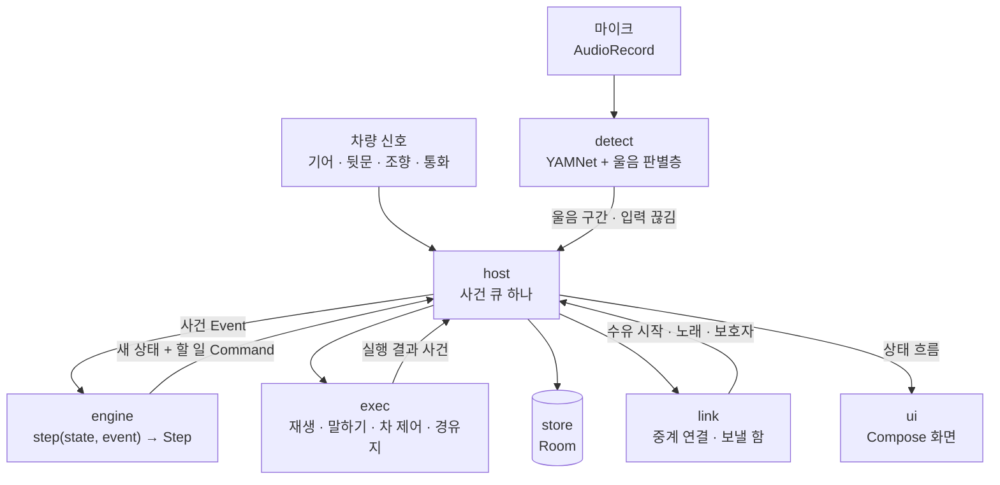
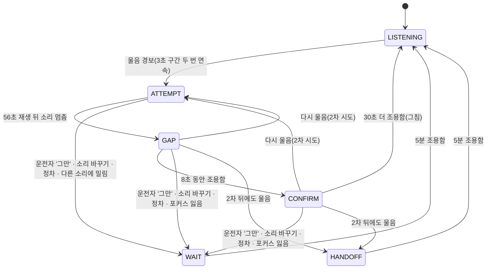

# 아이곁 구조와 동작 규칙

[README](README.md)가 '무엇을, 어떻게 실행하나'라면 이 문서는 '어떻게 만들었나'입니다. 숫자와 규칙의 기준은 코드와 시험이고, 이 문서는 길잡이입니다.

## 1. 한눈에

- 울음 판정과 달래기는 **차 안에서 끝납니다.** 마이크 소리는 저장하지도, 차 밖으로 보내지도 않습니다.
- 연결된 보호자 휴대폰으로(중계를 거쳐) 차가 보내는 것은 아래와 같습니다. 휴대폰이 차로 보내는 것은 수유 시작, 부모 노래, 수유·수면·기저귀 돌봄 요약입니다.
  - 주행 리포트: 주행 시작·끝 시각, 울음과 달래기 기록, 틀어 본 소리 이름과 부모 노래의 곡 이름, 인계 때의 쉼터 이름, 조향·차량 제어 기록, 소리별 성적
  - 리포트에 든 울음 직전 주행 상황: 속도, 브레이크·조향·방향지시등 사용, 기어, 실내 온도, 소리 재생 여부
  - 인계 알림: 알림 글, 쉼터 이름, 도착까지 남은 분
  - 마지막 수유 시각과 다음 수유 예상 시각, 노래 상태
- AI 서버로(중계를 거쳐) 가는 것은 운전자가 말로 물었을 때의 **질문 글자**(아이 별명은 '아기'로 바꿈)와 그때의 **상태 값**(울음·수유·잠·기저귀 요약, 카시트 시간, 실내 온도, 소리별 성적, 다음 쉼터의 이름·거리·수유실 유무와 식별값(쉼터 종류와 이름으로 만든 값))입니다. 마이크 소리와 차 위치 좌표는 어느 쪽으로도 보내지 않습니다.
- 차와 휴대폰은 서로 직접 붙지 않고 중계를 거칩니다. 메시지 형식은 `shared/`의 타입과 JSON 예제가 기준입니다.

## 2. 모듈

| 모듈 | 하는 일 | 층 |
| --- | --- | --- |
| `engine/` | 판단 코어. 세션·달래기·판정·인계 규칙을 담은 상태 기계 | 도메인(순수 Kotlin, 플랫폼 import 없음) |
| `app/` | 차 앱. 감지(`detect`), SDK 실행(`exec`), 상주 호스트(`host`), 중계 연결(`link`), 기록(`store`), 화면(`ui`) | 앱·데이터·화면 |
| `shared/` | 차·휴대폰·중계가 함께 쓰는 메시지 타입과 JSON 예제 | 계약 |
| `phone/android/`, `phone/ios/` | 휴대폰 앱. 같은 구조를 Kotlin·Swift로 각각 | 도메인·데이터·화면 |
| `relay/` | 차·휴대폰 사이 중계, LLM 대리 호출, 푸시 | 서버 |

의존은 한 방향입니다: 화면 → 앱(유스케이스) → 도메인 ← 데이터. 객체는 생성자로 주입하고, 조립은 플랫폼마다 한 곳에서 합니다(차 `app/…/host/Wiring.kt`, 안드로이드 `…/di/AppContainer.kt`, iOS `App/AppContainer.swift`). DI 라이브러리는 쓰지 않습니다.

## 3. 차 앱

### 판단 코어

- **순수 함수 하나입니다.** `Engine.step(state, event)`는 새 상태, 할 일 목록(`Command`), 다음에 깨울 시각을 돌려줍니다. 시계·난수·저장소·SDK를 직접 만지지 않아 같은 입력이면 늘 같은 결과가 나오고, JVM 시험으로 전부 검증합니다.
- **단계는 sealed 타입입니다.** `Stage`(`engine/…/Stage.kt`)는 단계에만 의미 있는 값(재생, 판정 창, 조용함 누적)을 그 단계 안에만 두어, 단계와 맞지 않는 값 조합을 만들 수 없습니다.
- **칸마다 쓰는 곳이 하나입니다.** 상태 칸은 주인 리듀서 파일에서만 바뀌고, 시험(`OwnershipTest`)이 소스를 읽어 이를 지킵니다.
- **기다리는 일은 표 하나로 정리합니다.** 말하기·질문·경유지 응답처럼 결과를 기다리는 것은 `Waiting` 타입이고, 세션 끝·복원·장면 시작 같은 사건에서 무엇을 버리고 남길지는 한 함수의 표가 정합니다(`Waiting.kt`).
- **늦게 온 결과는 문맥으로 가립니다.** 재생·말하기·차 제어의 결과는 그것을 낼 때 잡아 둔 문맥과 맞을 때만 반영합니다.

### 달래기 한 번의 흐름

- `WAIT`는 자동 달래기 중(재생·듣기·확인 어느 단계든) 판정 없이 멈췄을 때 가는 대기 단계입니다.
- 그림은 주된 길만 그렸습니다. `HANDOFF`로는 한 세션의 재생 누적이 상한(20분)에 닿을 때(시도를 시작하거나 재생이 끝난 직후), 첫 자동 시도 재생이 뒷좌석 출력이 없어 거절될 때도 갑니다(`HandoffCause`의 `SESSION_CAP`·`NO_SOUND`).
- 값(56초·8초·30초·자동 시도 2회)은 `engine/…/Params.kt`에 있습니다. 제품 설계값이고 임상 기준이 아닙니다.
- 재생을 켠 채 판정하지 않습니다. 노래를 울음으로 잘못 듣는 경우가 있어, 소리를 멈추고 듣습니다([측정](tools/measure/README.md#맥-오프라인-평가)).
- 마이크 입력이 끊기거나 판정을 중간에 멈추면 '그침'으로 치지 않고 **판정하지 못함**으로 남깁니다.

### 동작 규칙과 코드 위치

| 규칙 | 내용 | 코드 |
| --- | --- | --- |
| 울음 감지 | MediaPipe YAMNet 점수 위에 직접 학습한 로지스틱 회귀 판별층. 3초 구간이 두 번 연속 문턱을 넘으면 경보 | `app/…/detect/`, `tools/cry-retrain/` |
| 뒷좌석 재생 | 출력 장치를 뒷좌석 오디오 존으로 지정. 뒷좌석 출력이 없는 차는 설정에서 허용했을 때만 앞에서 작게 | `app/…/exec/Player.kt` |
| 소리 고르기 | 판정이 난 1차 시도의 결과(28일)를 쌓아 고름: 소리마다 2번씩 먼저 써 보고 그다음 톰슨 샘플링. 수유 시간대의 1차 시도는 성적이 가장 좋은 소리 | `engine/…/Calc.kt`, `SootheReducer.kt` |
| 2차 시도 | 실내가 26℃ 이상이면(세션에 한 번) 같은 소리를 틀며 앞 공조 설정을 2℃ 낮추고, 아니면 성적이 가장 좋은 다른 소리로 바꿈 | `engine/…/SootheReducer.kt`, `ControlReducer.kt` |
| 수유 시간대 | 마지막 수유 뒤 수유 간격의 0.8~2배가 지나는 동안. 이때 울어 1차나 2차 시도(덥지 않을 때)를 시작하면, 정차(P) 중이 아닐 때 수유한 지 얼마인지 알리고 경로 앞 쉼터를 제안: 30km 안 가장 가까운 곳, 그보다 5km 안에 수유실 휴게소가 있으면 그곳. 넣을 쉼터가 없으면 세워서 돌보라는 안내, 도착까지 10분 이하면 제안 없음 | `engine/…/SootheReducer.kt`, `OfferReducer.kt`, `Calc.kt` |
| 인계 | 두 번 해도 울면 넘김(한 세션의 재생이 20분에 닿거나, 뒷좌석 출력이 없어 첫 소리를 틀지 못할 때도): 다른 보호자가 있으면 휴대폰에 알림. 운전자에게는 도착 10분 이내면 도착 안내, 아니면 경로 앞 휴게소·졸음쉼터를 경유지로 넣을지 묻고(응이라 하면 추가), 쉼터가 없으면 세워서 돌보라고 안내. 정차 중이면 안내 없이 알림만 | `engine/…/OfferReducer.kt` |
| 차량 제어 | 세션을 열 때와 세션 중 켜질 때 아기 자리 열선 끄기, 형제가 있으면 세션을 열 때 뒷창 잠금(세션이 끝나면 되돌림), 정차 중 1차 시도 때 아기 자리 독서등 끄기, 무드 조명이 켜져 있으면 달래는 동안 낮추고 끝나면 되돌림(그 사이 운전자가 바꾼 밝기는 건드리지 않음) | `engine/…/ControlReducer.kt`, `app/…/exec/` |
| 말 미루기 | 브레이크·방향지시등·큰 조향(30도 이상)으로 운전이 바쁜 동안(끝난 뒤 3초) 급하지 않은 안내(수유 경과, 수유실·장시간 운전 쉼터 제안, 쉼터를 못 찾았다는 안내)는 미루고, 30초 넘게 미뤄지면 버림. 일반 쉼터에 들를지 묻는 질문은 미루지 않음 | `engine/…/SpeechReducer.kt` |
| 말로 묻기 | 안내 직후 5초(세션 중), '물어보기' 단추(정차 중에만). 자장가·부모 노래가 나오는 동안 들은 말은 질문으로 받지 않음 | `engine/…/Rules.kt`, `QaReducer.kt` |
| 질문 답 | LLM은 주제와 도구(소리 바꾸기·경유지·멈춤)를 고르고, 기록·차 상태를 묻는 질문은 차가 값을 읽어 정해 둔 문장으로 답함. 그 밖의 글은 숫자·상태 단정·군말 검사를 통과할 때만 앞 두 문장을 말하고, 통과하지 못하거나 답이 늦으면 정해 둔 문장 | `app/…/link/Qa.kt`, `engine/…/NumberCheck.kt` |
| 주행 중 화면 | 주행 제한이 걸리거나 아직 모르면 단추 없는 주행 화면 하나만 그림 | `app/…/ui/` |
| 복원 | 프로세스가 다시 뜨면 스냅숏과 Room을 대조해 이어 가고, 말하던 줄·열려 있던 질문은 버림 | `app/…/host/RestoreUseCase.kt`, `engine/…/Restore.kt` |

## 4. 휴대폰 앱

두 앱은 같은 구조와 같은 이름을 씁니다.

- **도메인:** 모델·규칙·유스케이스(연결, 연결 유지, 받은 함 맞추기, 보낼 함 보내기, 돌봄 기록, 노래). 플랫폼 UI 프레임워크를 import하지 않습니다.
- **데이터:** 중계 HTTP·WebSocket, 파일 저장소, 자격 보관(Keystore·Keychain), 녹음.
- **화면:** 화면마다 ViewModel과 불변 상태(안드로이드 `StateFlow`, iOS `@Observable`). 화면은 상태를 그리기만 합니다.
- **연결 상태·보낼 항목·받은 메시지**는 sealed 타입·연관값 enum으로 표현해 불가능한 조합을 막습니다.
- 두 앱이 어긋나지 않게 **같은 예제 파일**(`shared/src/test/resources/`의 JSON 예제 46개, CSV 가져오기 기대값, 디자인 토큰)을 양쪽 시험이 함께 읽습니다.

## 5. 중계 서버

- Cloudflare Worker가 요청을 받아 차마다 하나인 Durable Object(SQLite)로 넘깁니다. 메시지는 받는 쪽이 가져갈 때까지 최대 7일 보관합니다.
- 연결은 차가 만든 6자리 코드(5분)로 하고, 보호자는 초대 코드로 더합니다. 역할(차·owner·guardian)마다 보낼 수 있는 메시지 종류가 정해져 있습니다.
- LLM 키를 앱에 넣지 않으려고 중계가 대신 부릅니다. LLM이나 중계에 닿지 못하면 차는 정해 둔 문장으로 답합니다.
- 배포와 비밀값은 [relay/README.md](relay/README.md)에 있습니다.

## 6. 시험

| 대상 | 시험 | 줄 커버리지 |
| --- | --- | --- |
| 판단 코어 `engine/` | 상태 전이·규칙 단위 시험 | 약 98%(CI가 95% 하한을 강제) |
| 차 앱 `app/` | Robolectric + Room으로 호스트·기록·연결·실행기, 가짜 호스트로 장면 27개 끝까지 | 약 53%(SDK 어댑터와 Compose 그리기 코드는 단위 시험 밖) |
| 안드로이드 폰 | 도메인·유스케이스·화면 상태 | 약 40%(도메인 모델 96%) |
| iOS 폰 | 도메인·유스케이스·화면 상태 | 약 44%(도메인 93~98%) |
| 중계 `relay/` | Workers 런타임에서 vitest | 약 98% |

- **커버리지는** Gradle 모듈(`engine/`·`app/`·안드로이드 폰)은 Kover(`./gradlew -Pcoverage …`, 차 앱·폰은 Room·Compose가 만든 코드를 뺀 값), iOS는 `xcodebuild test -enableCodeCoverage YES`, 중계는 vitest 커버리지(istanbul)를 임시로 더해 쟀고 저장소 의존성에는 넣지 않았습니다.
- **골든 파일:** JSON 예제 46개(메시지 22개, API 요청·응답 24개)는 `shared`·iOS 휴대폰 앱·중계의 시험이 전부 읽어 왕복 대조하고, 차 앱과 안드로이드 휴대폰 앱의 시험은 자기가 주고받는 예제를 골라 확인합니다. 음성 문장 표, 장면의 할 일 기록, 화면에 나가는 글자도 파일로 고정했습니다.
- **에뮬레이터 실측**(경보 지연, 뒷좌석 재생, 주행 중 차량 제어, 내비 경유지, 자원)은 [tools/measure/README.md](tools/measure/README.md)에 기록과 함께 있습니다.
- 전체 시험은 `tools/check.sh` 한 번으로 돕니다. CI는 [.github/workflows/ci.yml](.github/workflows/ci.yml)입니다.
