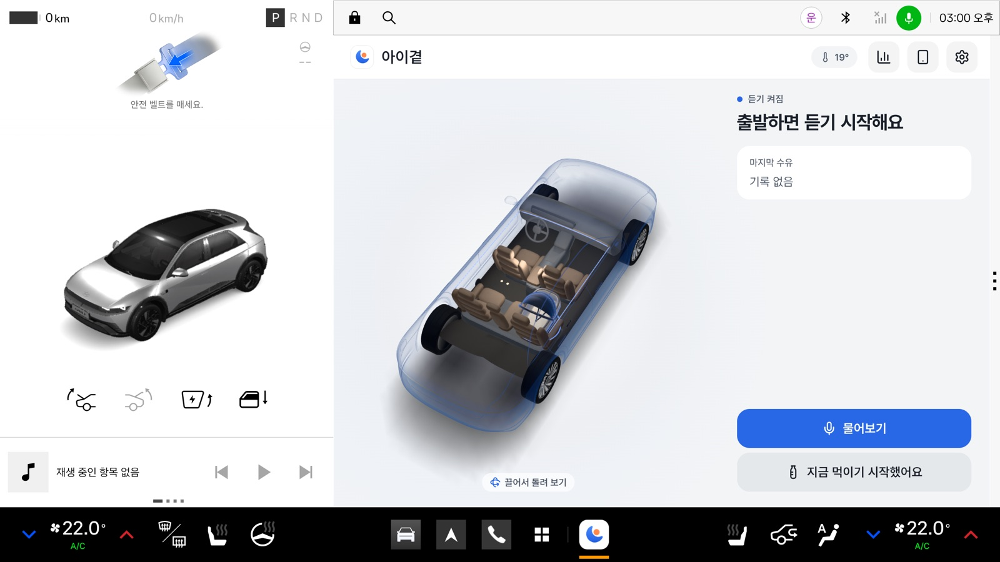
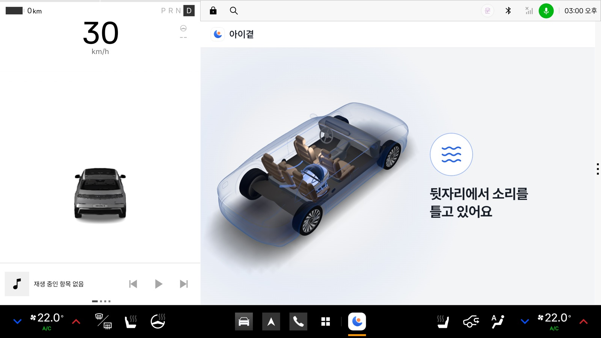
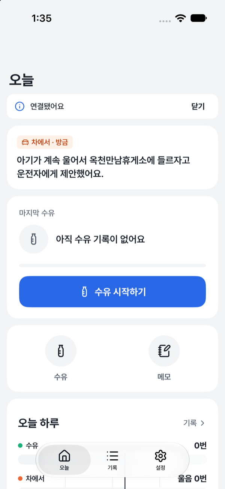

# 아이곁

[](https://github.com/WooRaZil-Boy/aigyeot/actions/workflows/ci.yml)
[](ARCHITECTURE.md#6-시험)
[](#테스트-환경과-필요한-설정)
[](gradle/libs.versions.toml)
[](phone/ios)
[](relay)
[](LICENSE)

> 아기가 울면 차가 대신 달래 줍니다. 부모는 앞만 보고 운전합니다.

뒷좌석 카시트에 2세 이하 아기를 태우고 혼자 운전하는 부모를 위한 Pleos Connect(Android Automotive) 앱입니다. 차가 마이크로 울음을 듣고 뒷좌석 스피커로 달래며, 두 번 달래도 울면 쉼터 정차를 안내하고 다른 보호자에게 알립니다. 현대자동차그룹 차량용 앱 개발 공모전 출품작이고, 차량용 앱·보호자 휴대폰 앱(안드로이드·iOS)·중계 서버로 이루어져 있습니다.

| 정차 홈 | 달래는 중(주행) | 휴대폰 보호자 알림 |
| :---: | :---: | :---: |
|  |  |  |

| 항목 | 내용 |
| --- | --- |
| APK | 차량용 앱 [`apk/곁빛_아이곁_release.apk`](apk/곁빛_아이곁_release.apk), 안드로이드 휴대폰 앱 [`apk/곁빛_아이곁_휴대폰_release.apk`](apk/곁빛_아이곁_휴대폰_release.apk). 둘 다 release 키로 서명 |
| 실행 | 에뮬레이터를 띄우고 `SERIAL=<차 에뮬레이터 시리얼> tools/demo/prepare.sh apk/곁빛_아이곁_release.apk` ([실행 방법](#실행-방법)) |
| 테스트 환경 | Pleos Connect Emulator v2.1.0(Android 14, API 34, 2560×1440), macOS(Apple Silicon) ([테스트 환경과 필요한 설정](#테스트-환경과-필요한-설정)) |
| 개발·검증 자료 | https://aigyeot-site.byuncorry.workers.dev (검증 결과·실제 화면·디자인 시안·개발 도구. 원본은 [`site/`](site)) |
| 구조와 규칙 | [ARCHITECTURE.md](ARCHITECTURE.md) |

## 주요 기능

- **차 안에서 듣기:** 차 마이크 소리를 차 안에서 판정합니다(MediaPipe YAMNet 위에 직접 학습한 울음 판별층). 마이크 소리는 저장하거나 차 밖으로 보내지 않습니다.
- **뒷좌석에서 달래기:** 달래는 소리를 뒷좌석 오디오 존으로 틀고, 운전자에게는 "뒤에서 울어요. 뒷자리에 자장가 틀었어요." 같은 짧은 문장으로 알립니다. 56초 틀고 멈춰 8초 듣고, 조용하면 소리를 끈 채 30초 더 확인해 그쳤는지 판정합니다.
- **달래기 횟수 제한·정차 안내:** 한 차례 울음에 자동으로 달래는 것은 두 번까지입니다. 그래도 울면 자동 재생을 멈추고, 운전자에게 경로 앞 휴게소·졸음쉼터에 들를지 묻거나 도착·정차를 안내하며, 연결된 다른 보호자의 휴대폰에 알립니다(보호자 알림).
- **차량 제어:** 아기 자리 시트 열선 끄기, '뒷창 잠그기'를 켜 두면 뒷창 잠금, 달래는 동안 무드 조명 낮추기, 실내가 더우면 앞 공조 설정 낮추기.
- **기록으로 소리 고르기:** 어떤 소리를 틀었을 때 그쳤는지 쌓아 다음에 틀 소리를 고릅니다(톰슨 샘플링). 리포트에는 "소리 덕분인지는 알 수 없어요"라고 함께 적습니다.
- **음성 질문·명령:** "뭐가 제일 잘 통해?", "언제 먹였지?"처럼 물으면 기록과 차 상태로 답합니다. 정차 중에는 홈의 '물어보기' 단추를 누르고 묻고, 주행 중에는 화면에 단추가 없어 차가 안내를 마친 직후 5초 동안 묻습니다. 질문 글자와 그때의 상태 값은 중계 서버를 거쳐 외부 LLM으로 갑니다([보내는 것](ARCHITECTURE.md#1-한눈에)).
- **휴대폰 앱:** 수유·잠·기저귀 기록, 다른 육아 앱 기록 가져오기(CSV), 부모 노래 녹음, 주행 리포트, 보호자 알림(앱 화면에서는 '인계 알림').

울음의 원인을 맞히지 않고, 잠·호흡을 감지하지 않습니다. 위는 주된 흐름의 요약입니다. 언제·어떤 조건에서 하는지와 설계값, 코드 위치는 [ARCHITECTURE.md](ARCHITECTURE.md#동작-규칙과-코드-위치)의 규칙 표가 기준입니다.

## 실행 방법

명령은 저장소 루트에서 실행합니다. `adb`·`emulator`가 PATH에 있어야 하고, 시연 스크립트는 bash·curl·python3를 씁니다. 스크립트가 하는 일과 자세한 절차는 [tools/demo/README.md](tools/demo/README.md)에 있습니다.

**1. 에뮬레이터 준비** — [공식 설치 문서](https://document.pleos.ai/en/docs/connect/guide/getting-started/application-development/setup-connect-sdk-emulator#setting-up-the-emulator)대로 AVD를 만듭니다(시스템 이미지 API 34 `Pleos Connect v2.1.0 APIs` arm64-v8a, 기기 프로필 `Pleos Connect v2.1.0`, RAM 4GB, Cold boot).

```bash
emulator -avd <AVD 이름> -timezone Asia/Seoul
adb devices                                       # 차 에뮬레이터 시리얼 확인(예: emulator-5554)
```

**2. 제출 APK 설치와 첫 실행** — `prepare.sh`가 APK를 설치하고 운전자 사용자(user 10) 권한과 차량 상태를 맞춥니다. `SERIAL`에는 1단계에서 확인한 시리얼을 넣습니다(빼면 스크립트는 `emulator-5560`을 찾습니다).

```bash
SERIAL=emulator-5554 tools/demo/prepare.sh apk/곁빛_아이곁_release.apk
```

처음 실행하면 '아기 설정'을 마쳐야 홈이 나옵니다. 정차 화면에서 '아기 탔어요'를 누른 뒤 짧게 달려 봅니다(기어 D·30km/h로 25초 달리고 정차해 뒷문을 여닫아 주행을 끝냅니다). 달리는 동안 앱은 단추 없는 주행 화면으로 바뀝니다.

```bash
SERIAL=emulator-5554 tools/demo/drive.sh
```

**3. 울음 감지 보기** — 가상 오디오 장치로 에뮬레이터 마이크에 울음 녹음을 넣으면 경보 → 뒷좌석 재생 → 그쳤는지 판정까지 이어집니다. 에뮬레이터를 `-allow-host-audio`로 띄우는 것부터 순서가 따로 있으니 [제출 APK로 울음 감지 보기](tools/demo/README.md#제출-apk로-울음-감지-보기)를 처음부터 따라 합니다(맥에 가상 오디오 장치와 `ffmpeg`이 있어야 합니다).

**4. 휴대폰 앱** — 제출 APK는 배포한 중계 서버에 붙으므로 따로 띄울 것이 없습니다. 안드로이드는 일반 에뮬레이터(API 26 이상)에 `adb -s <폰 에뮬레이터 시리얼> install -r apk/곁빛_아이곁_휴대폰_release.apk`, iOS는 `phone/ios/Aigyeot.xcodeproj`를 Xcode로 열어 `Aigyeot` 스킴의 실행 구성을 `Release`로 바꿔(Edit Scheme → Run → Build Configuration. Debug는 로컬 중계 서버에 붙습니다) 시뮬레이터에서 실행합니다. 차량용 앱 홈 오른쪽 위 휴대폰 단추를 누르면 나오는 코드를 휴대폰 앱에 넣어 연결하고, '아기 탔어요' 뒤 2단계의 `drive.sh` 명령으로 달리면 주행이 끝날 때 리포트가 휴대폰에 옵니다(울음이 없었으면 '울음 기록 없음').

**5. 시연 장면(debug 빌드)** — 같은 상황을 매번 똑같이 재연하는 장면 재생기(장면 27개)는 개발·측정용이라 debug 빌드에만 있습니다. 장면 목록과 실행 순서는 [tools/demo/README.md](tools/demo/README.md#장면-실행)에 있습니다.

## 테스트 환경과 필요한 설정

제출 APK를 받아 실행하는 데 필요한 환경입니다. 소스를 빌드한 개발 환경은 [소스 빌드와 시험](#소스-빌드와-시험)에 있습니다.

| 구분 | 내용 |
| --- | --- |
| Pleos Connect 에뮬레이터 | v2.1.0(시스템 이미지 `Pleos Connect v2.1.0 APIs`, Android 14·API 34, arm64-v8a), 기기 프로필 `Pleos Connect v2.1.0`(2560×1440, mdpi), RAM 4GB |
| 확인한 호스트 | macOS(Apple Silicon). Windows·Linux(x86_64)에서는 실행해 보지 않았습니다(APK에는 x86_64 라이브러리도 들어 있음) |
| 필요한 도구 | Android SDK의 `adb`·`emulator`(PATH에 있어야 함), 시연 스크립트용 bash·curl·python3 |
| 울음 감지 확인(선택) | 가상 오디오 장치(예: BlackHole 2ch)와 `ffmpeg`. 에뮬레이터는 `-allow-host-audio`로 띄웁니다 |
| 휴대폰 앱 | 안드로이드는 일반 에뮬레이터(API 26 이상), iOS는 Xcode에서 시뮬레이터로 실행(최소 iOS 17.0) |
| 네트워크 | 제출 APK는 배포한 중계 서버에 붙으므로 인터넷 연결만 있으면 되고, 따로 띄울 서버는 없습니다 |

- **설정:** 에뮬레이터는 `-timezone Asia/Seoul`로 띄웁니다. 운전자 사용자(user 10)의 권한과 차량 상태는 `tools/demo/prepare.sh`가 맞춥니다([실행 방법](#실행-방법) 2단계).

## 소스 빌드와 시험

```bash
./gradlew :app:assembleDebug     # 차량용 앱 debug → app/build/outputs/apk/debug/app-debug.apk
./gradlew :app:assembleRelease   # 차량용 앱 release(서명 키 설정이 없으면 서명 없이 만듦)
tools/check.sh                   # 린트와 시험 전부: ktlint, engine·shared·app·phone(JVM), 시연 스크립트, relay, iOS 시험·SwiftLint
```

단위 시험은 2,500개 이상, 판단 코어의 줄 커버리지는 약 98%입니다(CI가 95% 하한을 강제). 모듈별 수치와 시험 방식은 [ARCHITECTURE.md](ARCHITECTURE.md#6-시험)에 있습니다.

**개발 환경**(이 저장소를 빌드하고 시험한 환경)

| 구분 | 값 |
| --- | --- |
| 개발 맥 | macOS 27.0.1, Apple Silicon(arm64) |
| 차량용 앱 | compileSdk 37 / targetSdk 34 / minSdk 28, ABI arm64-v8a·x86_64 |
| Pleos SDK | Vehicle 2.3.2, NaviHelper 3.0.5, SpeechToText 3.3.1, TextToSpeech 3.3.1 |
| 울음 감지 | MediaPipe tasks-audio 0.10.32(YAMNet) |
| 안드로이드 빌드 | Gradle 9.6.0, AGP 9.4.1, Kotlin 2.4.21, JDK는 Android Studio 내장(OpenJDK 25.0.3), 컴파일 대상 Java 17 |
| 안드로이드 휴대폰 앱 | compileSdk 37 / targetSdk 36 / minSdk 26 |
| iOS 휴대폰 앱 | Xcode 27.2, 최소 iOS 17.0, XcodeGen 2.45.3 |
| 중계 서버 | Node.js v25.4.0에서 확인(wrangler 4.156.0은 22 이상, vitest 5.0.5는 22.12·24·26 이상을 적어 둠), Cloudflare Workers + Durable Objects |

- **필수:** 루트 `local.properties`에 `sdk.dir=<Android SDK 경로>`(또는 환경 변수 `ANDROID_HOME`). `JAVA_HOME`이 없으면 Android Studio 내장 JDK를 지정합니다(macOS: `export JAVA_HOME="/Applications/Android Studio.app/Contents/jbr/Contents/Home"`).
- **선택(release 서명):** `local.properties`에 `aigyeot.release.storeFile`·`storePassword`·`keyAlias`·`keyPassword` 넷이 모두 있으면 서명합니다. 키는 저장소에 두지 않습니다.
- **선택(로컬 중계 서버·LLM 답·원격 푸시):** debug 빌드는 맥의 로컬 중계 서버에 붙습니다. 키 설정은 [relay/README.md](relay/README.md)와 [tools/demo/README.md](tools/demo/README.md#debug로-돌리기녹음-장면인계-알림로컬-중계-서버)에 있습니다. 키가 없으면 음성 질문에는 정해 둔 문장으로 답하고 원격 푸시만 꺼집니다.

## Pleos SDK와 차량 신호를 쓰는 곳

| SDK·API | 아이곁에서 쓰는 곳 |
| --- | --- |
| Vehicle(읽기) | 뒷문 열림·닫힘으로 운행 세션 시작·끝, 시트 열선·공조 온도·창 잠금·조명 상태, 조향각·브레이크·방향지시등 |
| Vehicle(제어) | 아기 자리 시트 열선 끄기, 뒷창 잠금·풀기, 앞 공조 2℃ 낮춤, 정차 중 뒷좌석 독서등 끄기, 무드 조명 낮추기·되돌리기 |
| NaviHelper | 안내 중 여부, 남은 시간·거리, 경로 위 휴게소·졸음쉼터, 경유지 넣기 |
| TextToSpeech / SpeechToText | 운전자에게 하는 안내 / '응·아니', 운전자 질문, 멈춤 말. 둘 다 기기 안(ON_DEVICE) 모드 |
| AAOS `CarPropertyManager`·`CarPowerManager`·`CarUxRestrictions` | 기어·속도, 시동 꺼짐·켜짐 짐작, 주행 제한 때 주행 화면으로 전환 |
| Android `AudioTrack`·`MediaPlayer` | 출력 장치를 뒷좌석 오디오 존으로 지정해 재생 |

권한 전체는 [AndroidManifest.xml](app/src/main/AndroidManifest.xml)에 있습니다. Pleos Playground의 SDK 사용 신청에서 Vehicle Control·TextToSpeech·SpeechToText는 아직 '준비 중'입니다. 공식 에뮬레이터에서 매니페스트 권한 선언으로 동작을 확인했고, 실차 동작과 App Market 심사 통과는 확인하지 않았습니다.

## 검증 결과

에뮬레이터 실측 중 경보 지연·내비 경유지·자원은 debug 빌드 차량용 앱으로, 뒷좌석 재생·주행 중 차량 제어는 별도 실측 앱([tools/pleos-probe](tools/pleos-probe/))으로 쟀습니다. 울음 감지와 그침 판정은 휴대폰·가정 녹음에 차 소음을 섞어 맥에서 평가했습니다. 조건과 전체 표는 [tools/measure/README.md](tools/measure/README.md)에 있습니다. 제출 APK로는 실행 절차를 따로 따라 해 확인했고([readme_walkthrough_1114.txt](tools/measure/readme_walkthrough_1114.txt)), 마이크 경로의 울음 감지는 11-13에 만든 release 빌드로 확인했습니다([blackhole_cry_1113.txt](tools/measure/blackhole_cry_1113.txt)).

| 항목 | 결과 | 기록 |
| --- | --- | --- |
| 경보 지연(울음 입력 → 첫 달래기 재생 명령. 장면이 마이크 자리에 울음 녹음을 넣음) | 에뮬레이터 장면 6회 중앙값 2,464ms, 최대 3,515ms | [perf_1108.txt](tools/measure/perf_1108.txt) |
| 뒷좌석 재생 | 출력 장치를 지정하면 뒷좌석 존 `bus100_audio_zone_1`으로 나감 | [rear_audio_1102.txt](tools/pleos-probe/rear_audio_1102.txt) |
| 주행 중 차량 제어 | 기어 D·60km/h에서 시트 열선·창 잠금·공조 온도·무드 조명 색 24/24 반영 | [babycare_Drive.txt](tools/sim/babycare_Drive.txt) |
| 내비 경유지 | 앱이 넣은 휴게소가 실제 내비 경로에 '경유'로 들어옴 | [emulator_1110.txt](tools/measure/emulator_1110.txt) 4절 |
| 자원(3D 화면 포함) | CPU 한 코어 기준 구간 평균 1.63~4.03%, 메모리(PSS) 최대 252MB | [demo_check_1112.txt](tools/measure/demo_check_1112.txt) 7절 |
| 울음 감지(교차검증, 울음 대 차 소음 비 10 dB) | 재현율 378/457(0.83). 오경보 수치와 조건은 [tools/measure/README.md](tools/measure/README.md#맥-오프라인-평가) | [tools/cry-retrain](tools/cry-retrain/) |
| 그침·계속 판정(학습에 쓰지 않은 울음 18개로 만든 맥 합성 장면 360개) | 소리를 멈추고 들을 때 359/360. 재생을 켠 채 판정한 비교 장면(따로 만듦)에서는 동요를 튼 장면에서 실제로 그친 72번 중 18번을 '아직 운다'로 잘못 봄 | [tools/cry-retrain](tools/cry-retrain/) |

## 알려진 한계

- 아기가 실제로 덜 우는지, 운전자가 덜 돌아보는지는 재지 않았습니다. 앱의 성적은 '그 소리를 틀었을 때 그친 횟수'입니다.
- 감지 수치는 휴대폰·가정 녹음에 차 소음을 섞어 맥에서 잰 값입니다. 차 안 녹음과 시간당 오경보는 재지 않았습니다.
- 에뮬레이터 소리는 맥 스피커로 나와 앞·뒤로 나뉘어 들리는지 확인할 수 없고, 실차 오디오 존 구성도 확인하지 않았습니다.
- 원격 푸시는 키를 넣지 않아 백그라운드 도착을 확인하지 않았습니다.
- 울음 판별층은 비상업 조건 데이터가 들어간 학습이라 공모전 시연용입니다.

전체 목록은 [tools/measure/README.md](tools/measure/README.md#알려진-한계와-확인하지-못한-것)에 있습니다.

## 저장소 구성

| 위치 | 내용 |
| --- | --- |
| `app/` | 차량용 앱(Pleos Connect). 감지·SDK 실행·상주 서비스·휴대폰 연결·기록·화면 |
| `engine/` | 판단 코어. 순수 Kotlin 상태 기계 |
| `shared/` | 차·휴대폰·중계가 함께 쓰는 메시지 형식과 JSON 예제 |
| `phone/android/`, `phone/ios/` | 휴대폰 앱(Kotlin·Jetpack Compose, SwiftUI) |
| `relay/` | 중계 서버(Cloudflare Workers + Durable Objects) |
| `tools/` | 시연 스크립트(`demo`), 실측 기록(`measure`), 울음 판별층 학습·평가(`cry-retrain`), 에뮬레이터 실측 앱(`pleos-probe`), 시뮬레이션(`sim`), 전체 시험(`check.sh`) |
| `apk/` | 제출용 release APK |
| `site/` | 검증 결과·실제 화면·디자인 시안·개발 도구를 모은 정적 페이지(브라우저에서 `index.html`을 열면 됨) |

## 라이선스와 출처

코드의 저작권은 저작권자에게 있으며 심사·평가·학습을 위한 열람·빌드·실행을 허용합니다([LICENSE](LICENSE)). 바탕 모델(YAMNet, MediaPipe), 서체, 아이콘, 라이브러리, 공공데이터, 판별층 학습 데이터의 출처와 라이선스는 [NOTICE.md](NOTICE.md)에 있습니다.
